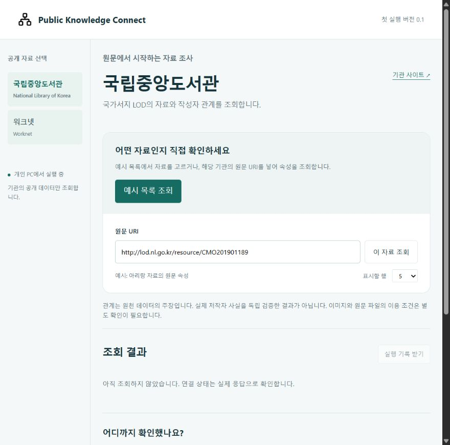
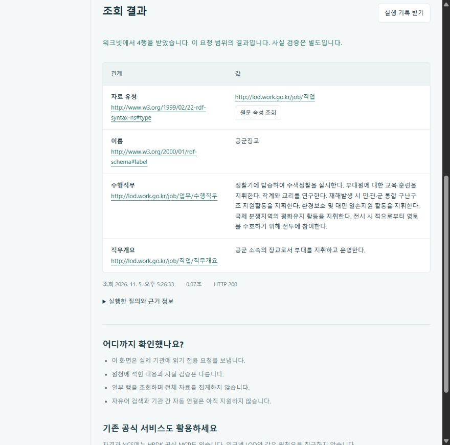

# Public Knowledge Connect

**Read public linked data from your own AI and inspect the source behind a result.**

[한국어](README.md) · [Validation](docs/VALIDATION.md) · [Roadmap](docs/ROADMAP.md)

Public data may be openly available yet difficult to connect to a personal AI assistant. Each source has its own endpoint, query conventions and response format. This project handles that connection through a local web interface and MCP, using the identifiers and relationships already published by the source.

This first runnable version connects the **National Library of Korea and Worknet**. It retrieves example records, follows supported resource links and displays their properties. Free-text search and joins between agencies are not implemented.



## Run locally

Install Node.js 24 or later. Internet access is required. These queries need no API key or paid language model.

```sh
git clone https://github.com/SakJaeLim/public-knowledge-connect.git
cd public-knowledge-connect
npm ci --ignore-scripts
npm start
```

Open [http://127.0.0.1:8784](http://127.0.0.1:8784) on the same computer. The current web interface is in Korean.

1. Select the library and click **예시 목록 조회** to fetch examples.
2. Click **원문 속성 조회** under a record or creator to inspect that resource.
3. Select Worknet and inspect an example occupation's duties and description.
4. Use **실행 기록 받기** to download the query, provenance, timestamps and outcome as JSON. Failed requests can also be saved.

Source assertions are not independently verified facts. A bounded result is not a full-dataset count.



These screenshots show actual source queries on 5 November 2026. Later responses may differ.

## Connect an AI client

Use a client that supports local stdio MCP servers. The web server does not need to run.

```sh
npm run config:mcp
```

This prints configuration containing the current Node executable and absolute project path. Add it to your client's MCP configuration. The command does not edit settings. A remote connector URL field cannot use this local stdio configuration or a localhost URL.

Try asking: “List the available public sources. Pick a library example, follow its creator link, and include the source URIs.”

| Tool | Purpose |
|---|---|
| `list_public_sources` | List sources, capabilities and caveats |
| `query_public_records` | Fetch `examples` or `describe` a supported resource URI |

The official MCP SDK client has been used to test negotiation and live tool calls. Installation and answer quality have not been tested in every consumer AI application, including Claude.

## What it is useful for

Researchers and public-data users can inspect the evidence behind an AI-assisted lookup. A library record can lead to its creator resource. An occupation resource exposes duties and an overview with the original identifier preserved.

Finding an arbitrary target by a natural-language question is future work. This release establishes a working source connection, provenance and explicit failure handling. It is not yet a team wiki, ontology editor or unified public-data search service.

## Sources and boundaries

| Source | Data read here | Scope |
|---|---|---|
| [National Library of Korea LOD](https://lod.nl.go.kr/home/) | Bibliographic records, creator links and properties | Separate from the InfoNaru MCP service |
| [Worknet LOD](https://lod.work.go.kr/) | Occupation names, duties and descriptions | Not current job listings or qualification decisions |

Prefer official tools where they already solve the task. See the [library's InfoNaru MCP announcement](https://www.nl.go.kr/NL/contents/N50603000000.do?id=58649&schBcid=normal0302&schM=view) and [HRDK MCP](https://openapi.hrdkorea.or.kr/mcp.html). This project is independent of those providers and does not claim to replace their services.

Upstream availability varies. Verification observed both successful Worknet responses and an HTTP 404. The app reports a failure rather than treating it as no results or substituting cached demo data. Check each source's terms before redistributing records, images or full text.

## Implementation

The web interface and stdio MCP server share the same query core. Source profiles define allowed URIs and fixed query templates. Responses are normalized, size-checked and returned with query text, source links, timestamps, a response hash and an explicit status.

Requests are limited to 20 displayed rows, 2 MB and 20 seconds. The web server binds only to loopback and rejects foreign origins and unexpected Host headers. Arbitrary endpoints and user-supplied SPARQL are not accepted. The app does not read private documents or AI API keys. It does not persist query history automatically; users may download individual run records.

The original contribution is the source adapters, bounded resource navigation, response normalization, shared web/MCP execution and evidence/error reporting. It reuses published RDF vocabularies and resource identifiers rather than creating a new ontology.

## Verification

```sh
npm test
npm run verify:live
```

Offline tests cover input validation, failure classification, response limits, web request boundaries and MCP behavior. Live verification calls both sources through MCP and writes `artifacts/live-verification.json`; artifacts are excluded from Git.

On 5 November 2026, 12 automated tests and live MCP calls to both sources passed on Windows. The in-app browser was used to check source selection, example lists, resource properties and run-record downloads. See [validation notes](docs/VALIDATION.md) for CI and platform scope. Offline CI cannot establish current source availability or AI answer accuracy.

## Next steps

First, improve installation and retrieval around a concrete user task. **Team Wiki is the next separate development stage:** synchronize a Google Drive folder, link wiki passages to source versions, and re-review passages after changes. The existing evidence-review module remains a candidate for that integration.

The [roadmap](docs/ROADMAP.md) and [research plan](docs/RESEARCH.md) distinguish planned work from implemented features. No research benchmark or user-impact study has been completed.

## License and credits

Original code is [MIT licensed](LICENSE). The UI uses Open Props and Lucide; MCP uses the official TypeScript SDK and Zod. Versions and notices are in [THIRD_PARTY_NOTICES.md](THIRD_PARTY_NOTICES.md). The software license does not grant redistribution rights to source data.
