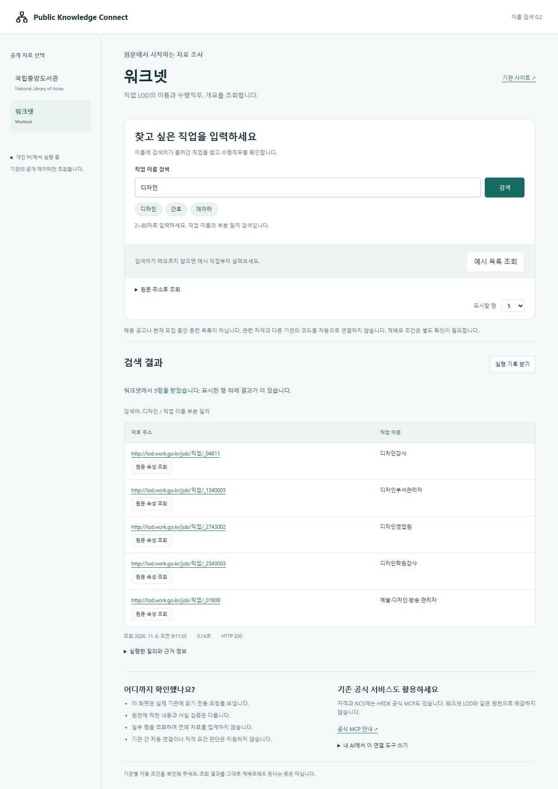
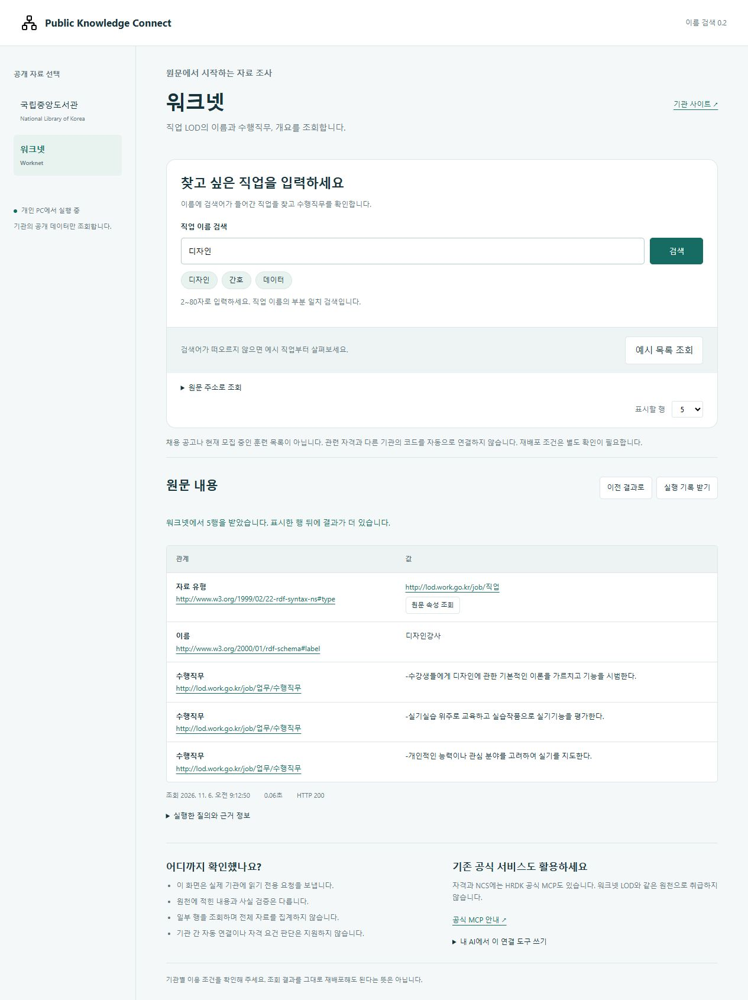
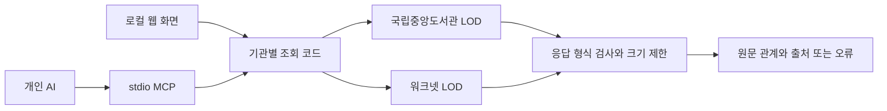

# Public Knowledge Connect

**공개된 LOD 자료를 내 AI에서 조회하고, 답변에 쓰인 원문까지 확인하는 로컬 도구.**

[English](README.en.md) · [실행 검증](docs/VALIDATION.md) · [개발 순서](docs/ROADMAP.md)

공공기관이 자료를 공개해도 개인 AI에 연결하려면 기관마다 다른 주소, 질의 방식과 응답 형식을 알아야 합니다. 이 프로젝트는 그 연결 작업을 맡습니다. 기관이 이미 만든 데이터와 관계를 활용하며, 원천을 새로 수집해 거대한 데이터베이스를 만드는 방식은 아닙니다.

현재 **국립중앙도서관과 워크넷을 연결합니다.** 워크넷에서는 ‘디자인’처럼 직업 이름의 일부를 입력해 대상을 찾고, 그 직업의 수행직무와 원문을 확인할 수 있습니다. 도서관은 예시 목록과 원문 주소 조회를 지원합니다. 질문의 의미를 이해하는 검색과 기관 간 자동 결합은 아직 지원하지 않습니다.

예를 들어 **디자인 관련 직업 찾기 → 디자인강사의 수행직무 확인 → 검색 목록으로 돌아가기 → 출처가 담긴 기록 저장**을 웹 화면이나 MCP로 진행할 수 있습니다. 웹의 목록 복귀는 기존 응답을 보여주며 다시 조회하지 않습니다.



## 먼저 써 보기

Node.js 24 이상과 인터넷 연결이 필요합니다. 조회에 별도 API 키나 유료 모델은 사용하지 않습니다.

```sh
git clone https://github.com/SakJaeLim/public-knowledge-connect.git
cd public-knowledge-connect
npm ci --ignore-scripts
npm start
```

[http://127.0.0.1:8784](http://127.0.0.1:8784)를 엽니다. 서버를 실행한 PC에서만 접속할 수 있습니다.

1. 처음 열리는 **워크넷** 화면에서 ‘디자인’을 입력하고 **검색**을 누릅니다.
2. ‘디자인강사’의 **원문 속성 조회**를 눌러 수행직무를 확인합니다.
3. **이전 결과로**를 누르면 같은 조회 시각의 검색 목록으로 돌아옵니다.
4. **실행 기록 받기**로 검색어, 질의, 출처, 조회 시각과 응답 상태를 JSON 파일에 저장합니다. 실패한 요청도 기록할 수 있습니다.

국립중앙도서관은 왼쪽에서 선택한 뒤 **예시 목록 조회**를 누르세요. 자료나 작성자의 **원문 속성 조회**를 누르면 연결된 항목을 확인할 수 있습니다.

자료의 이름과 관계는 원천에 기록된 내용입니다. 저작자나 자격 요건이 실제로 맞는지 검증한 결과는 아닙니다. 일부 행만 조회하므로 전체 자료를 집계한 결과로 사용하면 안 됩니다.

<details>
<summary>검색한 직업의 수행직무 화면 보기</summary>



</details>

화면은 2026년 11월 6일 실제 기관에 요청해 확인한 결과입니다. 이후 원천의 응답은 달라질 수 있습니다.

## 내 AI에 연결하기

로컬 stdio MCP를 지원하는 클라이언트에서 사용할 수 있습니다. 웹 서버를 켜둘 필요는 없습니다.

```sh
npm run config:mcp
```

현재 PC의 Node 실행 파일과 프로젝트 경로가 포함된 설정이 출력됩니다. 사용하는 클라이언트의 MCP 설정에 추가하세요. 이 명령은 설정 파일을 자동으로 바꾸지 않습니다. 원격 서비스의 커넥터 주소 입력란에 localhost를 넣는 방식과는 다릅니다.

연결 후에는 이렇게 요청해 보세요.

> 워크넷에서 디자인 관련 직업을 찾아 하나의 수행직무와 출처를 보여줘.

AI가 먼저 `search`에 짧은 검색어를 전달하고, 반환된 URI로 `describe`를 호출하는 흐름입니다. 검색 요청 예시는 다음과 같습니다.

```json
{"source":"worknet","operation":"search","term":"디자인","limit":5}
```

| 도구 | 역할 |
|---|---|
| `list_public_sources` | 기관, 지원 기능과 원천별 주의사항 확인 |
| `query_public_records` | 워크넷 이름 `search`, 두 기관의 `examples`와 원문 URI `describe` |

MCP 공식 SDK 클라이언트로 초기 연결과 실제 도구 호출을 시험했습니다. Claude 등 개별 AI 앱에서의 설치 및 답변 품질을 모두 검증한 상태는 아닙니다.

## 어디에 쓰나

연구자나 공공데이터 활용자가 AI 답변의 근거를 살펴볼 때 사용할 수 있습니다. 예를 들어 도서관 자료를 조회한 뒤 작성자 항목으로 이동해 원천에 어떤 관계가 기록돼 있는지 확인합니다. 직업 조사에서는 워크넷에 기록된 수행직무와 직무개요를 원문 주소와 함께 가져옵니다.

워크넷 검색은 2~80자 검색어가 직업 이름에 포함되는지 확인합니다. 짧은 단어로 찾을 수 있지만, 질문 전체의 의미나 유사어를 추론하지 않습니다. 도서관 제목 검색은 실제 시험에서 20초 제한 시간을 넘겨 이번 버전에 넣지 않았습니다. 팀 Wiki와 온톨로지 편집은 별도 개발 범위입니다.

## 연결한 원천

| 원천 | 이번 버전에서 읽는 자료 | 이용 범위 |
|---|---|---|
| [국립중앙도서관 LOD](https://lod.nl.go.kr/home/) | 자료, 작성자와 원문 속성 | 국가서지 LOD. 도서관 정보나루 MCP와 별도 원천 |
| [워크넷 LOD](https://lod.work.go.kr/) | 직업 이름, 수행직무와 직무개요 | 채용 공고나 실시간 모집 정보가 아님 |

공식 MCP가 해결하는 과제에는 공식 도구를 사용하는 것이 좋습니다. [국립중앙도서관의 정보나루 MCP 안내](https://www.nl.go.kr/NL/contents/N50603000000.do?id=58649&schBcid=normal0302&schM=view)와 [HRDK 공식 MCP](https://openapi.hrdkorea.or.kr/mcp.html)도 참고하세요. 이 프로젝트가 이들 서비스의 공식 제품이거나 대체 서비스라는 뜻은 아닙니다.

원천의 운영 상태에 따라 조회가 실패할 수 있습니다. 실제 검증 중 워크넷의 성공 응답과 HTTP 404 응답을 모두 관찰했습니다. 실패를 빈 결과로 바꾸거나 저장된 예시 데이터로 감추지 않습니다. 원천 자료, 이미지와 원문 파일의 재배포 조건은 별도로 확인해야 합니다.

## 어떻게 동작하나



직접 구현한 부분은 기관별 조회 규칙, 응답 정규화, 제한된 원문 탐색, 웹 화면과 MCP의 공통 실행 코드, 조회 증빙과 오류 구분입니다. 기존 RDF 어휘와 기관의 식별자를 그대로 사용합니다. 임의의 SPARQL이나 외부 서버 주소는 실행하지 않습니다.

이름 검색은 [워크넷 공식 질의 예제](https://lod.work.go.kr/lod_example.do)의 직업 유형과 이름 속성을 사용합니다. 검색어를 문자열로 이스케이프하고, 이름과 URI 순으로 정렬해 제한된 결과를 반환합니다. 요청한 행 수보다 한 행 더 확인해 추가 결과가 있는지도 표시합니다.

요청당 최대 20행, 응답 2 MB, 제한 시간 20초를 적용합니다. 웹 서버는 loopback에만 열리고 외부 Origin과 잘못된 Host 요청을 거부합니다. 조회 대상은 공개 기관 주소로 고정됩니다. 개인 문서나 AI API 키를 읽지 않습니다. 서버에는 조회 이력이 자동 저장되지 않으며, 실행 기록은 사용자가 내려받을 때 저장됩니다.

## 검증과 현재 상태

```sh
npm test
npm run verify:live
npm run verify:search
```

`npm test`는 네트워크 없이 입력 검증, 오류 구분, 응답 크기 제한, 웹 요청 보호와 MCP 동작을 시험합니다. `verify:live`는 두 기관의 원문 조회, `verify:search`는 워크넷 검색 3건, 검색 결과의 원문 조회 1건과 결과 없음 1건을 공식 SDK의 별도 프로세스로 실행합니다. 결과는 Git에서 제외한 `artifacts/`에 저장합니다.

2026년 11월 6일 Windows에서 자동 검사 18개와 실제 검색 검증을 통과했습니다. 내장 브라우저에서 검색, 수행직무 조회, 이전 결과 복귀, 결과 없음과 기록 다운로드도 확인했습니다. Windows, macOS, Linux의 Node 24 CI를 운영합니다. 운영체제별 확인 범위와 결과는 [검증 기록](docs/VALIDATION.md)에서 구분합니다. 이 검사는 검색 정확도나 AI 답변 품질을 평가한 실험이 아닙니다.

## 다음 개발

다음 확인 과제는 개인 AI 앱에서 실제 설치와 검색을 수행하고, 사람이 기대 근거를 정한 질문으로 결과를 비교하는 것입니다. 이어서 별도 단계로 **팀 문서를 Wiki로 유지하는 도구**를 개발합니다. Google Drive 폴더의 변경을 반영하고 Wiki 문장과 원문 버전을 연결하는 것이 첫 범위입니다. 기존 근거 검토 모듈은 그 단계에서 재사용할 대상으로 남겨둡니다.

[개발 순서](docs/ROADMAP.md)와 [연구 준비](docs/RESEARCH.md)에 구현 범위와 비교 기준을 적었습니다. 논문 실험이나 사용자 효과 측정은 아직 수행하지 않았습니다.

## 라이선스와 사용한 오픈소스

직접 작성한 코드는 [MIT](LICENSE)입니다. 화면에는 Open Props와 Lucide를, MCP에는 공식 TypeScript SDK와 Zod를 사용합니다. 버전과 원저작자 고지는 [THIRD_PARTY_NOTICES.md](THIRD_PARTY_NOTICES.md)에 있습니다. 코드 라이선스가 조회한 공공자료의 재배포 권한까지 부여하지는 않습니다.
