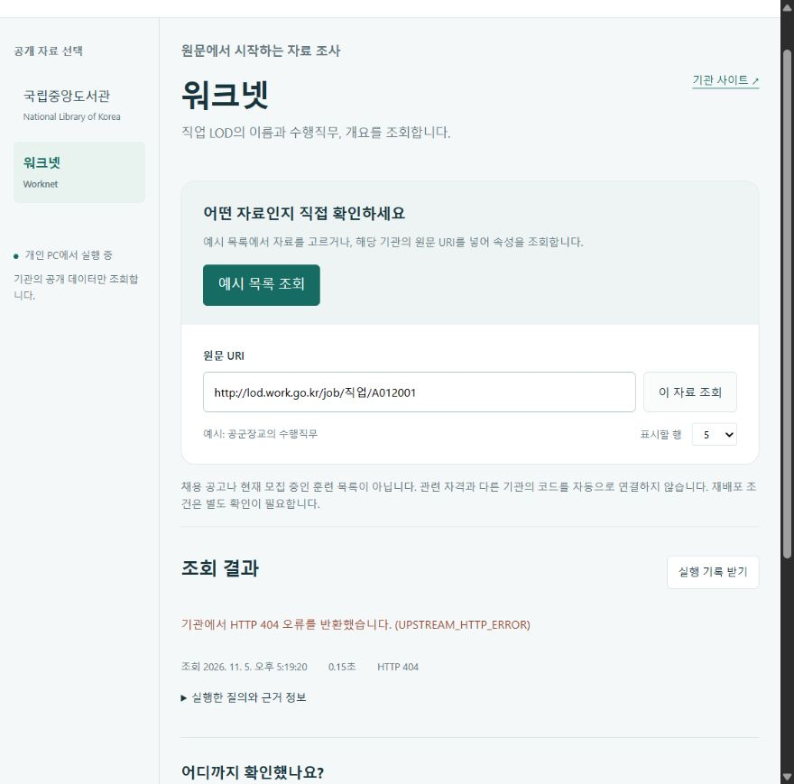

# 실행 검증

검증일: 2026-11-05. 서로 다른 확인 범위를 구분한다.

| 확인 | 결과 | 범위 |
|---|---|---|
| Windows, Node 24.22.1 자동 검사 | 12개 통과 | 입력 제한, 오류 구분, 응답 크기, 웹 요청 보호, MCP 도구 |
| 공식 SDK stdio 클라이언트 | 연결 및 도구 호출 성공 | 실제 별도 Node 프로세스 실행 |
| 국립중앙도서관 원문 조회 | HTTP 200, 표시 5행 | `CMO201901189`의 속성, 전체 수집 아님 |
| 워크넷 원문 조회 | HTTP 200, 4행 | `직업/A012001`의 속성 |
| 내장 브라우저 | 목록, 속성, 관계 이동, 기록 다운로드 확인 | Windows에서 실행 |
| 원천 장애 관찰 | 워크넷 HTTP 404도 발생 | 성공했던 동일 질의. 실패 기록 다운로드 확인 |
| npm audit | 알려진 취약점 0건 | 검사 시점의 의존성 보고. 전체 보안 보증 아님 |
| macOS / Linux 실제 기관 조회 | 미확인 | 로컬 Windows 결과를 다른 OS 검증으로 확대하지 않음 |
| Claude 등 AI 앱의 답변 평가 | 미수행 | SDK 연결 시험과 별도 |
| 모바일 너비 | 미확인 | 내장 브라우저의 너비 변경이 반영되지 않아 모바일 통과로 기록하지 않음 |

웹 화면에서는 두 기관의 예시 목록과 원문 조회, 도서관의 작성자 관계 이동, 잘못된 주소 거부, 실제 원천 HTTP 오류 표시와 오류 기록 다운로드를 확인했다. 마무리 화면의 브라우저 오류 로그는 비어 있었다.



실제 응답 원문과 해시는 로컬 `artifacts/`에 보관한다. 공공자료의 재배포 조건을 확인하지 않은 상태에서 저장소에 원문을 대량 포함하지 않는다. 자동 테스트의 자료는 직접 만든 작은 테스트 문자열이다.

CI에는 Windows, macOS와 Linux에서 Node 24로 실행하는 네트워크 없는 검사를 구성한다. 성공 여부는 실제 워크플로 실행 결과를 확인한 후 기록한다. CI는 원천 기관의 현재 가용성을 검사하지 않는다.

## 재현

```sh
npm ci --ignore-scripts
npm test
npm run verify:live
```

`verify:live`는 두 원천이 모두 비어 있지 않은 정상 응답을 반환할 때만 성공 종료한다. 시간 초과, 오류 또는 빈 결과면 실패 종료하고 받은 결과를 기록한다. 기관 데이터와 응답 상태는 이후 달라질 수 있다.
